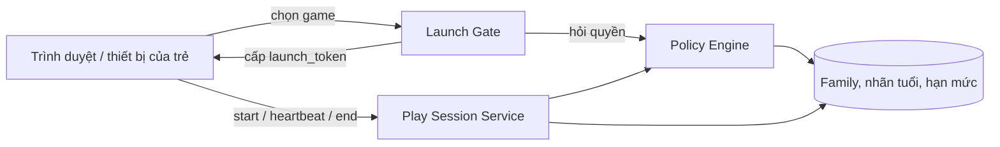
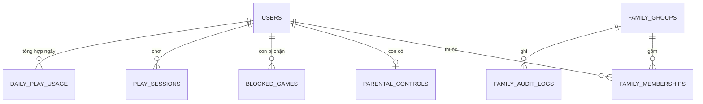
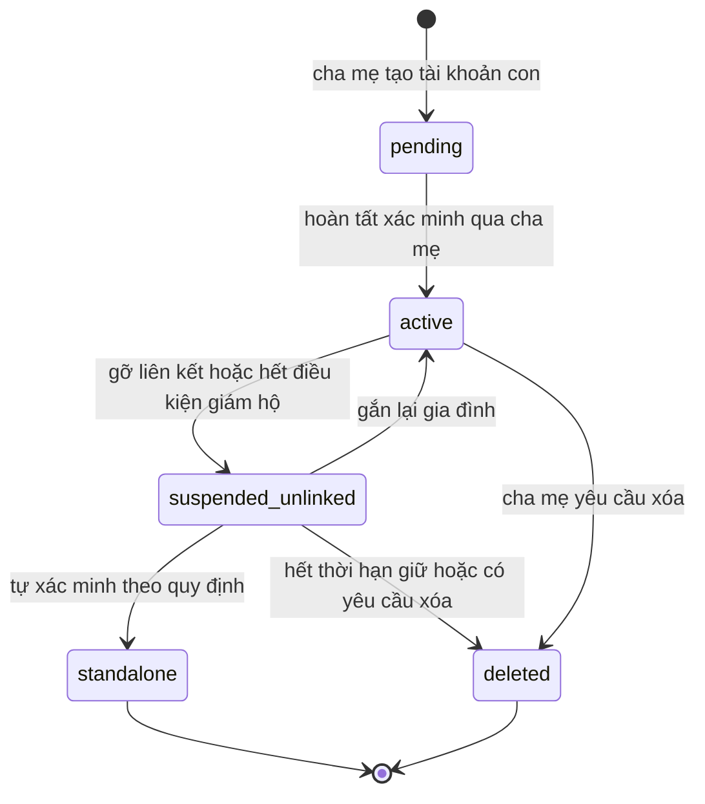

# GameVui Family — Kế hoạch triển khai

| Mục | Nội dung |
|---|---|
| Tên tài liệu | `trien-khai.md` |
| Phiên bản | 2.0 — rà soát và viết lại từ bản v1 (thay đổi chính: Phụ lục B) |
| Sản phẩm | GameVui Family — hệ thống tài khoản cha mẹ và tài khoản con trên GameVui.vn |
| Trạng thái | **Bản nháp chờ review.** Không sửa database, không triển khai production trước khi qua Gate G0 (§6, §13) |
| Thứ tự ưu tiên | An toàn trẻ em → tương thích tài khoản hiện hữu → thương mại hóa |
| Thời gian mục tiêu | 12 tuần + 2 tuần dự phòng, tính từ khi có quyền truy cập codebase và người phụ trách (§13) |
| Người phụ trách | Product/Project Lead: `[điền]` · Tech Lead: `[điền]` · Pháp chế: `[điền]` · Bảo mật: `[điền]` |

**Quy ước đọc tài liệu**

| Nhãn | Ý nghĩa |
|---|---|
| `[ĐÃ CHỐT]` | Quyết định đã thống nhất; chỉ bàn lại khi có bằng chứng mới |
| `[ĐỀ XUẤT]` | Mặc định khuyến nghị; có hiệu lực nếu không bị phản đối trước hạn chốt trong §5 |
| `[XÁC MINH]` | Phụ thuộc vào mã nguồn thực tế hoặc ý kiến pháp chế; chưa được coi là sự thật |

Mọi giá trị số (thời gian, ngưỡng, giới hạn) là **điểm khởi đầu**: phải nằm trong cấu hình, không hard-code, và được hiệu chỉnh ở giai đoạn beta.

---

## 1. Tóm tắt điều hành

**Vấn đề (giả thuyết cần kiểm chứng ở beta).** Phụ huynh muốn cho con chơi game trên GameVui nhưng chưa có cách quản lý nội dung theo độ tuổi và thời lượng chơi mà không phải dùng chung mật khẩu.

**Giải pháp.** GameVui Family cho phép một tài khoản người lớn quản lý một hoặc nhiều tài khoản trẻ em. Mỗi tài khoản con có username và mật khẩu riêng, đăng nhập độc lập trên PC, laptop và điện thoại. Dữ liệu chơi và chính sách gia đình được đồng bộ từ server và **do server thực thi**.

**Cách tiếp cận.** Mở rộng hệ thống tài khoản hiện hữu (xác thực số điện thoại, phân loại game theo độ tuổi); không xây hệ thống song song; không di chuyển hàng loạt người dùng cũ; phát hành từng đợt bằng feature flag.

### 1.1. Bối cảnh pháp lý (pháp chế phải đối chiếu văn bản gốc)

- Nghị định 147/2024/NĐ-CP (áp dụng từ 25/12/2024) yêu cầu tài khoản trò chơi điện tử trên mạng được xác thực bằng số điện thoại di động tại Việt Nam (hoặc số định danh cá nhân). Với người chơi dưới 16 tuổi, cha mẹ hoặc người giám hộ là người đăng ký thông tin và chịu trách nhiệm về tài khoản.
- Dự thảo sửa đổi Nghị định này (đang lấy ý kiến, tháng 7/2026) đề xuất siết cơ chế xác thực, yêu cầu hệ thống kỹ thuật quản lý thời gian chơi và giới hạn 60 phút/ngày cho người dưới 16 tuổi trên toàn bộ game của cùng một doanh nghiệp. Nội dung dự thảo có thể thay đổi.
- Các nguồn tin chưa thống nhất về giới hạn thời gian hiện hành (180 phút/ngày hay 60 phút/game) và về phạm vi áp dụng đối với các game trên GameVui. `[XÁC MINH]` — xem Phụ lục A.

**Hệ quả thiết kế:**

1. GameVui Family có thể trở thành **năng lực tuân thủ**, không chỉ là tính năng tạo niềm tin. Hạn mức pháp định phải cấu hình được ở server; phụ huynh chỉ được đặt **chặt hơn**, không được nới hơn.
2. Tính năng bảo vệ cốt lõi và các yêu cầu pháp định **không bao giờ nằm sau paywall**.
3. Mô hình "tài khoản con được cha mẹ đăng ký và xác minh qua số điện thoại của cha mẹ" nhiều khả năng phù hợp với hướng quản lý, nhưng vẫn phải được pháp chế và nhà cung cấp OTP xác nhận trước khi code (D03).

### 1.2. Các quyết định định hướng đã thống nhất `[ĐÃ CHỐT]`

1. Chọn **Phương án A**: tài khoản cha mẹ và tài khoản con riêng biệt, liên kết bằng quan hệ gia đình.
2. Tài khoản hiện hữu hoạt động như cũ nếu người dùng không kích hoạt GameVui Family.
3. Tài khoản con đăng nhập độc lập bằng username và mật khẩu riêng trên nhiều thiết bị.
4. Số điện thoại đã xác minh của cha mẹ chỉ được dùng trong quy trình xác minh/giám sát tài khoản con **sau khi** kiểm tra kỹ thuật và xác nhận yêu cầu pháp lý, nhà cung cấp OTP, chính sách hiện hành. Không mặc định mọi tài khoản được dùng chung số điện thoại.
5. Ưu tiên an toàn cơ bản: phân loại nội dung, chặn game, giới hạn thời gian, bảo vệ cài đặt.
6. Mô hình doanh thu: cơ bản miễn phí + gói nâng cao trả phí, chỉ thử nghiệm sau khi MVP ổn định (§10).
7. Không suy đoán tuổi người dùng từ ngày tạo tài khoản; chỉ dùng thông tin tuổi đáng tin cậy theo quy trình đã phê duyệt.
8. Không sửa database hoặc triển khai production trước khi khảo sát codebase, xác định điểm tích hợp và có phương án rollback.

---

## 2. Mục tiêu, nguyên tắc và KPI

### 2.1. Mục tiêu sản phẩm

- Tăng niềm tin của phụ huynh đối với GameVui.
- Giúp cha mẹ tạo và quản lý tài khoản con mà không phải dùng chung mật khẩu.
- Cho phép phụ huynh cấu hình độ tuổi, game được phép/bị chặn và thời lượng chơi.
- Giữ nguyên tài khoản, điểm số, lịch sử chơi và chức năng hiện tại của người dùng cũ.
- Tạo nền tảng cho gói thuê bao nâng cao sau khi xác thực được nhu cầu thực tế.

### 2.2. Nguyên tắc sản phẩm và hệ quả thiết kế

| Nguyên tắc | Hệ quả thiết kế |
|---|---|
| **Safety first** | Không đánh đổi bảo vệ cơ bản để tăng doanh thu; mặc định an toàn khi thiếu dữ liệu (fail-closed) |
| **Backward compatible** | Migration chỉ bổ sung (additive); người dùng không tham gia không thấy thay đổi bắt buộc |
| **Server-authoritative** | Backend quyết định cuối cùng về quyền, chính sách, thời lượng; không chỉ ẩn nút trên giao diện |
| **Privacy by design** | Chỉ thu thập dữ liệu cần thiết; giới hạn quyền truy cập và thời gian lưu |
| **Incremental rollout** | Feature flag; nội bộ → beta → mở rộng dần; luôn có kill switch |
| **No destructive migration** | Không ghi đè dữ liệu cũ, không bắt chuyển đổi hàng loạt |
| **Measurable** | Mọi mục tiêu có chỉ số và ngưỡng (§2.3) |

### 2.3. KPI và ngưỡng khởi điểm

Ngưỡng được hiệu chỉnh tại Gate G0 sau khi có baseline (DISC-16) và tại G3 sau beta.

| Nhóm | Chỉ số | Ngưỡng khởi điểm |
|---|---|---|
| **An toàn (bắt buộc)** | Lỗi IDOR / nâng quyền / rò rỉ dữ liệu mức High trở lên còn mở | 0 |
| | Kịch bản chặn game / vượt hạn mức trong test plan bị fail | 0 |
| | Phiên chơi vượt hạn mức do lỗi hệ thống | < 0,5% tổng phiên của tài khoản con |
| **Ổn định, tương thích** | Tỷ lệ đăng nhập thành công của tài khoản cũ so với baseline | Không giảm quá 0,5 điểm phần trăm |
| | P95 độ trễ policy check khi bắt đầu phiên | ≤ 300 ms |
| | Tỷ lệ start-session thành công cho phiên hợp lệ | ≥ 99,5% |
| **Kích hoạt (beta)** | Phụ huynh bắt đầu kích hoạt → tạo ≥ 1 tài khoản con và đặt ≥ 1 quy tắc | ≥ 50% |
| | Tài khoản con có ≥ 1 phiên chơi trong 7 ngày sau khi tạo | ≥ 70% |
| **Hỗ trợ** | Khiếu nại về an toàn, dữ liệu, thanh toán trên 1.000 gia đình hoạt động | Theo dõi từ beta; đặt ngưỡng tại G3 |
| **Thương mại (sau MVP)** | Chuyển đổi dùng thử, gia hạn, hủy, hoàn tiền | Chốt sau khảo sát giá (§10.4) |

**Điều kiện phát hành bắt buộc:** không còn lỗi nghiêm trọng về phân quyền, truy cập chéo tài khoản, rò rỉ dữ liệu hoặc thực thi giới hạn an toàn (chi tiết §15.7).

---

## 3. Thuật ngữ

| Thuật ngữ | Định nghĩa dùng trong tài liệu |
|---|---|
| Tài khoản cha mẹ | Tài khoản người dùng hiện hữu đã xác minh và kích hoạt GameVui Family; là chủ quản của một gia đình |
| Tài khoản con | Tài khoản đăng nhập độc lập (ID riêng, dữ liệu chơi riêng) được tạo và giám sát bởi tài khoản cha mẹ |
| Gia đình (family) | Đối tượng gom tài khoản cha mẹ, các tài khoản con và thiết lập chung |
| Vùng Cha mẹ | Khu vực giao diện quản lý, được bảo vệ bằng PIN |
| Policy Engine | Thành phần server duy nhất quyết định "tài khoản con này có được chơi game này lúc này không" (§7.3) |
| Launch Gate | Lớp kiểm tra quyền trước khi game khởi chạy, cấp `launch_token` ngắn hạn |
| Hạn mức | Số phút được chơi trong một ngày theo `Asia/Ho_Chi_Minh` |
| Family Plus | Gói trả phí giả định, chỉ xét sau MVP |
| Gate (G0–G4) | Điểm kiểm soát Go/No-Go giữa các giai đoạn (§13.2) |

---

## 4. Phạm vi sản phẩm

Ký hiệu: **(M)** bắt buộc cho MVP · **(S)** nên có, làm nếu đủ nguồn lực sau khi các mục M đạt gate.

### 4.1. Trong phạm vi MVP

**Tài khoản và gia đình**

- (M) Entry point "Chế độ cha mẹ" trong khu vực tài khoản, chỉ hiển thị cho người đáp ứng điều kiện đã phê duyệt.
- (M) Quy trình giải thích tính năng, dữ liệu được xử lý và xác minh quyền quản lý.
- (M) Tạo hồ sơ gia đình; tạo tài khoản con với username và mật khẩu riêng; liên kết con với cha mẹ.
- (M) Đăng nhập tài khoản con độc lập trên nhiều thiết bị; chuyển giữa tài khoản cha mẹ và con theo D05.
- (M) Khôi phục thông tin đăng nhập của con do cha mẹ khởi tạo (D04).
- (M) PIN bảo vệ Vùng Cha mẹ.
- (M) Nhật ký thay đổi quan trọng trong thiết lập gia đình.
- (M) Tên hiển thị của con là bí danh; ẩn khỏi bảng xếp hạng công khai (D17).

**Kiểm soát an toàn**

- (M) Mức tuổi cho từng tài khoản con; lọc game theo nhãn độ tuổi hiện có.
- (M) Chặn game cụ thể.
- (M) Giới hạn thời lượng chơi mỗi ngày; hiển thị thời lượng đã dùng và còn lại.
- (S) Hạn mức riêng cho cuối tuần.
- (M) Không cho bắt đầu phiên mới khi hết hạn mức; xử lý phiên đang chạy khi hết giờ (D14).
- (M) Chính sách cho game chưa phân loại và công cụ gán nhãn tối thiểu (D07).
- (M) Không nạp quảng cáo nhắm mục tiêu và tracker bên thứ ba trong phiên của tài khoản con (D18).

**Quản lý và báo cáo**

- (M) Trang tổng quan gia đình; danh sách tài khoản con và trạng thái quy tắc.
- (M) Báo cáo thời lượng theo ngày/tuần ở mức cần thiết.
- (S) Danh sách game chơi nhiều, nếu dữ liệu sẵn có và phù hợp chính sách quyền riêng tư.
- (M) Thông báo cho cha mẹ về sự kiện quan trọng (D16).

**Vận hành**

- (M) Feature flag và kill switch; log/audit; metrics và cảnh báo.
- (M) Kiểm thử hồi quy tài khoản hiện tại; quy trình tắt tính năng/rollback.
- (M) Trang trợ giúp/FAQ và quy trình hỗ trợ trước beta (§12.6).

### 4.2. Ngoài phạm vi MVP

Trừ khi khảo sát cho thấy đã có sẵn và chi phí thấp, **không** làm trong MVP:

- Chat, kết bạn, mạng xã hội, nội dung do người dùng tạo.
- Kiểm soát toàn bộ thiết bị hoặc website ngoài GameVui; ứng dụng mobile riêng cho phụ huynh.
- AI đánh giá hành vi hoặc nội dung của trẻ; báo cáo quá chi tiết về hành vi cá nhân.
- Khung giờ được phép chơi, báo cáo dài hạn, allowlist game (dự kiến thuộc Family Plus hoặc giai đoạn sau).
- Đồng quản lý nhiều phụ huynh (co-parent).
- Thanh toán, gói gia đình nhiều tầng, khuyến mãi phức tạp, đa nhà cung cấp thanh toán.
- Thay mới hoàn toàn hệ thống tài khoản hiện hữu.

---

## 5. Nhật ký quyết định thiết kế

Bản v1 để nhiều mục ở dạng "cần chốt". Bản này đưa ra **mặc định khuyến nghị** để đội có thể làm ngay; quyết định nào còn `[XÁC MINH]` phải được giải quyết trước Gate G0 (hoặc Gate ghi trong cột hạn chốt).

| ID | Quyết định | Lý do | Trạng thái | Chủ trì · hạn |
|---|---|---|---|---|
| D01 | Tài khoản cha mẹ và con là hai tài khoản riêng, liên kết bằng quan hệ gia đình | Tách dữ liệu, tách quyền, không dùng chung mật khẩu | `[ĐÃ CHỐT]` | — |
| D02 | Một tài khoản con chỉ thuộc **một** gia đình; mỗi gia đình có **một** cha mẹ chủ quản; tối đa **5** tài khoản con/gia đình (cấu hình) | Đơn giản hóa phân quyền, hạn chế lạm dụng; co-parent để sau | `[ĐỀ XUẤT]` | PO · G0 |
| D03 | Xác minh tài khoản con theo nguồn `guardian`: con kế thừa trạng thái xác minh từ số điện thoại đã xác thực của cha mẹ thông qua quan hệ gia đình. **Số điện thoại không phải khóa định danh hay khóa đăng nhập**; không xóa unique constraint hiện có | Phù hợp hướng "cha mẹ đăng ký cho người dưới 16 tuổi", không phá ràng buộc cũ | `[XÁC MINH]` pháp chế + nhà cung cấp OTP | Pháp chế · G0 |
| D04 | Tài khoản con đăng nhập bằng username + mật khẩu, không có email/SĐT riêng. **Chỉ cha mẹ** được đặt lại thông tin đăng nhập; sau reset thu hồi mọi session của con và thông báo cho cha mẹ | Trẻ nhỏ không có kênh khôi phục an toàn | `[ĐỀ XUẤT]` | Tech Lead · G0 |
| D05 | Không impersonation: phiên cha mẹ và phiên con tách biệt; "chuyển hồ sơ" = đăng xuất rồi đăng nhập. Vùng Cha mẹ mở bằng PIN (hash phía server, sai 5 lần khóa 15 phút, phiên PIN 10 phút; đặt lại PIN cần mật khẩu + OTP) | Không chia sẻ session/quyền; tránh nâng quyền | `[ĐỀ XUẤT]` | Tech Lead · G0 |
| D06 | Chính sách theo nguyên tắc **deny wins** với thứ tự đánh giá cố định (§7.3) | Kết quả dự đoán được, dễ kiểm thử | `[ĐỀ XUẤT]` | Tech Lead · G0 |
| D07 | Game chưa có nhãn tuổi: **mặc định chặn** trong tài khoản con. MVP có công cụ gán nhãn tối thiểu (import CSV + màn hình quản trị). Nếu game chiếm < 90% lượt chơi 30 ngày gần nhất đã có nhãn tại G0, chạy sprint gán nhãn trước G2 | An toàn trước; tránh chặn nhầm hàng loạt | `[ĐỀ XUẤT]` | PO · G0 |
| D08 | Game không tích hợp được lớp khởi chạy/heartbeat (không thực thi được giới hạn thời gian) **không hiển thị** cho tài khoản con ở MVP | Không hứa điều không thực thi được | `[ĐỀ XUẤT]` | Game Dev 1 · G0 |
| D09 | Múi giờ tính hạn mức: `Asia/Ho_Chi_Minh`, reset 00:00; phiên qua nửa đêm được tách làm hai phần | Một quy tắc duy nhất, không phụ thuộc đồng hồ thiết bị | `[ĐỀ XUẤT]` | Tech Lead · G0 |
| D10 | Gói miễn phí: một hạn mức/ngày (+ hạn mức cuối tuần nếu làm được). Hạn mức tối đa do admin cấu hình (trần pháp định nếu có); phụ huynh chỉ đặt ≤ trần | Sẵn sàng khi quy định siết, không phải sửa kiến trúc | `[ĐỀ XUẤT]` + `[XÁC MINH]` trần pháp định | PO + Pháp chế · G0 |
| D11 | Mỗi tài khoản con chỉ có **một phiên chơi hoạt động** tại một thời điểm. Phiên mới trên thiết bị khác thay thế phiên cũ (phiên cũ nhận `session_replaced`) | Cộng thời gian không trùng ngay từ thiết kế; bỏ bài toán hợp nhất khoảng thời gian | `[ĐỀ XUẤT]` | Tech Lead · G0 |
| D12 | Heartbeat mỗi 30 giây; phiên hết hạn nếu 90 giây không có heartbeat; tối đa cộng thêm 30 giây sau heartbeat cuối; tab ẩn không gửi heartbeat | Cân bằng độ chính xác và tải | `[ĐỀ XUẤT]` (hiệu chỉnh ở beta) | Game Dev 2 · G1 |
| D13 | Không xác minh được chính sách / mất kết nối: **fail-closed** cho phiên mới; phiên đang chạy khóa giao diện sau 120 giây không đồng bộ được; thời gian chỉ được tính khi server xác nhận | An toàn trước trải nghiệm | `[ĐỀ XUẤT]` | PO + Tech Lead · G1 |
| D14 | Hết giờ: cảnh báo khi còn 5 phút và 1 phút; tại 0 hiển thị lớp phủ chặn thao tác và đóng phiên. Game có hook `onSessionEnding` được tối đa 30 giây để lưu tiến trình | Trải nghiệm thân thiện, vẫn thực thi cứng | `[ĐỀ XUẤT]` | Game Dev 2 · G1 |
| D15 | Gỡ liên kết hoặc con hết điều kiện giám hộ: tài khoản con chuyển `suspended_unlinked` — giữ nguyên dữ liệu, không chơi được cho đến khi gắn lại gia đình hoặc tự xác minh theo quy định; thời hạn giữ do pháp chế chốt (khởi điểm 90 ngày) | Tránh tài khoản trẻ "mồ côi" không có người xác minh | `[XÁC MINH]` | Pháp chế · G0 |
| D16 | Thông báo cho cha mẹ: in-app cho mọi sự kiện; SMS/email chỉ cho sự kiện bảo mật (reset đăng nhập, đổi PIN, tạo/gỡ tài khoản con) | Kiểm soát chi phí SMS/OTP | `[ĐỀ XUẤT]` | PO · G1 |
| D17 | Tên hiển thị của con là bí danh, không chứa thông tin định danh; tài khoản con mặc định **ẩn khỏi bảng xếp hạng công khai** và mọi khu vực tương tác | Giảm rủi ro lộ thông tin trẻ em | `[ĐỀ XUẤT]` | PO · G0 |
| D18 | Phiên tài khoản con không nạp quảng cáo nhắm mục tiêu hay tracker bên thứ ba | Dữ liệu trẻ em không dùng cho mục đích ngoài phạm vi | `[ĐỀ XUẤT]` | Web Dev 2 · G1 |
| D19 | Feature flag 3 lớp: `family.visible` (hiện entry point), `family.create` (cho tạo mới), `family.enforce` (áp dụng chính sách). Tắt `visible`/`create` không ảnh hưởng tài khoản đã tạo. Tắt `enforce` là hành động khẩn cấp, cần Tech Lead và PO cùng duyệt vì làm mất bảo vệ | Kill switch không được vô tình mở khóa game cho trẻ | `[ĐỀ XUẤT]` | Tech Lead · G1 |
| D20 | Thương mại hóa tách khỏi MVP: không thanh toán/paywall trước Gate G4. Code kiểm tra `entitlement` chứ không kiểm tra tên gói | Không để doanh thu làm chậm hoặc suy yếu an toàn | `[ĐỀ XUẤT]` | PO · G4 |

---

## 6. Giai đoạn 0 — Khảo sát codebase bắt buộc

**Không triển khai database/API trước khi hoàn thành giai đoạn này.** Giai đoạn 0 chạy song song với **track Pháp lý & OTP** (xem §13).

### 6.1. Tìm đúng repository

- Xác nhận repository thực sự chứa backend tài khoản GameVui.vn; xác định monorepo hay nhiều repository.
- Ghi lại nhánh chính, cách chạy local, cách build/test và quy trình deploy.
- Không suy đoán công nghệ từ các repository không liên quan.
- Không đưa secrets, token, mật khẩu hay dữ liệu người dùng thật vào tài liệu hoặc log.

### 6.2. Nội dung cần khảo sát

- Ngôn ngữ, framework, phiên bản runtime; database, migration tool, schema, index.
- Cấu trúc bảng người dùng và quan hệ dữ liệu.
- Luồng đăng ký, đăng nhập, đăng xuất, khôi phục mật khẩu.
- OTP: tạo, gửi, xác minh, hết hạn, giới hạn thử lại.
- Session/cookie/JWT: thời hạn, refresh, logout, thu hồi session; middleware xác thực/phân quyền.
- API điểm số, lịch sử chơi, yêu thích, chơi gần đây, hồ sơ.
- Quy trình triển khai, staging/production, rollback.
- Log, metrics, cảnh báo, feature flag.

### 6.3. Các câu hỏi cần trả lời

| ID | Câu hỏi | Bằng chứng cần ghi lại |
|---|---|---|
| DISC-01 | Backend dùng công nghệ gì? | File cấu hình, package, manifest |
| DISC-02 | Bảng user và khóa chính là gì? | Schema, migration |
| DISC-03 | Số điện thoại có unique constraint không (ở DB hay chỉ ở tầng ứng dụng)? | Schema, index, code validation |
| DISC-04 | OTP được quản lý thế nào? Nhà cung cấp có giới hạn số tài khoản/SĐT không? | Service, API, config (không ghi secret) |
| DISC-05 | Session được lưu và thu hồi ra sao? | Middleware, auth service |
| DISC-06 | Dữ liệu game liên kết với user bằng gì? | Schema và các API liên quan |
| DISC-07 | Nhãn độ tuổi game nằm ở đâu và ai quản trị? | Schema, API/màn hình quản trị game |
| DISC-08 | Game khởi chạy qua những điểm nào? | Route, controller, player integration |
| DISC-09 | Có thể thêm feature flag không? | Cấu hình, cơ chế release |
| DISC-10 | Có staging và dữ liệu kiểm thử an toàn (đã ẩn danh) không? | Quy trình deploy/test |
| DISC-11 | Tài khoản con có thể bị lộ hoặc tương tác ở đâu (bảng xếp hạng, bình luận, chat, hồ sơ công khai, mua hàng/vật phẩm)? | Danh sách route/màn hình |
| DISC-12 | Quảng cáo, analytics, SDK bên thứ ba được nạp ở những trang nào? | Danh sách script theo trang |
| DISC-13 | Kiểm kê game: số lượng, công nghệ (HTML5, Unity WebGL…), cách nhúng (iframe/trang riêng), khả năng tích hợp heartbeat | Bảng kiểm kê game |
| DISC-14 | Tài nguyên game được phục vụ thế nào (CDN/static)? Có ký URL hoặc kiểm tra token được không? | Cấu hình CDN, route |
| DISC-15 | Độ phủ nhãn tuổi theo lượt chơi 30 ngày gần nhất? | Truy vấn thống kê |
| DISC-16 | Baseline: DAU, số người chơi đồng thời đỉnh, tỷ lệ đăng nhập thành công, P95 API | Số liệu monitoring |

### 6.4. Đầu ra bắt buộc

- `docs/family/audit-codebase.md`: hiện trạng, có dẫn đường dẫn file/module.
- Sơ đồ luồng đăng ký, đăng nhập, OTP và truy cập game; sơ đồ quan hệ dữ liệu hiện tại.
- Danh sách ràng buộc có thể ảnh hưởng tài khoản con; danh sách rủi ro và đề xuất thay đổi tối thiểu.
- Bảng kiểm kê game (DISC-13) và báo cáo độ phủ nhãn (DISC-15).
- Ước lượng lại thời gian và nguồn lực; quyết định kỹ thuật đã được review.

### 6.5. Tiêu chí qua Gate G0

1. Báo cáo audit đã được review; không còn giả định chưa xác minh về kiến trúc tài khoản cốt lõi.
2. Các quyết định D02–D20 không còn ở trạng thái chặn (`[XÁC MINH]` của D03, D10, D15 đã có câu trả lời từ pháp chế).
3. Đã chọn phương án kỹ thuật cho Policy Engine và Launch Gate; có phương án rollback.
4. Đã có ước lượng person-week theo từng workstream và danh sách game đủ điều kiện tích hợp.
5. Product Owner, Tech Lead và Pháp chế cùng ký Go/No-Go.

---

## 7. Kiến trúc đề xuất

Đây là mô hình logic tham khảo, **không phải migration SQL đã được phê duyệt**. Tên bảng, trường và kiểu dữ liệu phải điều chỉnh theo codebase thực tế.

### 7.1. Thành phần

| Thành phần | Vai trò |
|---|---|
| Family Service | Quản lý gia đình, tài khoản con, quan hệ, PIN, audit |
| **Policy Engine** | Điểm quyết định duy nhất cho mọi câu hỏi "được chơi hay không"; được gọi ở danh mục game, Launch Gate, start-session, heartbeat |
| Launch Gate | Kiểm tra quyền trước khi game chạy, cấp `launch_token` ngắn hạn |
| Play Session Service | Quản lý phiên chơi, heartbeat, cộng thời lượng |
| Label Admin | Công cụ gán/duyệt nhãn tuổi cho game |
| Audit & Notification | Ghi nhật ký tối giản; gửi thông báo cho cha mẹ |

### 7.2. Thực thể và ràng buộc

| Bảng | Trường chính | Ràng buộc bắt buộc |
|---|---|---|
| `family_groups` | `id` (UUID), `owner_user_id`, `status`, `created_at`, `updated_at` | FK tới user; một cha mẹ chủ quản tối đa một gia đình (MVP) |
| `family_memberships` | `id`, `family_id`, `user_id`, `role` (`parent`/`child`), `status` (`pending`/`active`/`suspended_unlinked`/`removed`), `verification_source` (`guardian`/`self`), timestamps | Một user con chỉ có **một** membership đang hiệu lực (unique có điều kiện); giới hạn số con kiểm tra trong transaction; index `(family_id, status)` |
| `parental_controls` | `child_user_id`, `age_band` hoặc `birth_year` `[XÁC MINH]`, `daily_limit_minutes`, `weekend_limit_minutes` (nullable), `schedule_config` (nullable, dành cho Plus), `unknown_game_policy` (mặc định `deny`), `enabled`, `updated_by_user_id`, `updated_at`, `version` | Unique theo `child_user_id`; `version` để khóa lạc quan khi nhiều bên cùng sửa |
| `blocked_games` | `child_user_id`, `game_id`, `created_by_user_id`, `created_at` | Khóa chính `(child_user_id, game_id)` |
| `game_age_labels` (nếu chưa có) | `game_id`, `min_age`, `source`, `reviewed_by`, `reviewed_at`, `integration_level` | Một dòng hiệu lực mỗi game; theo kết quả DISC-07/13 |
| `play_sessions` | `id`, `user_id`, `game_id`, `started_at`, `last_heartbeat_at`, `ended_at`, `credited_seconds`, `end_reason` (`user_exit`/`timeout`/`limit_reached`/`replaced`/`policy_change`/`error`) | Chỉ một phiên mở mỗi `user_id`: unique có điều kiện `ended_at IS NULL`. Nếu DB không hỗ trợ partial index, dùng cột `active_slot` (NULL khi phiên đã đóng) với `UNIQUE(user_id, active_slot)`. Index `(user_id, started_at)` |
| `daily_play_usage` | `child_user_id`, `local_date`, `seconds_used`, `updated_at` | Khóa chính `(child_user_id, local_date)`; cập nhật nguyên tử, dùng để kiểm tra hạn mức nhanh |
| `family_audit_logs` | `id`, `family_id`, `actor_user_id`, `action`, `target_user_id`, `metadata_minimized`, `created_at` | Chỉ thêm, không sửa; không ghi mật khẩu, OTP, token, dữ liệu thừa |

Bảng thuê bao (`family_subscriptions`, `entitlements`) **chỉ được tạo ở giai đoạn thương mại hóa**, không có trong MVP.

### 7.3. Policy Engine — thứ tự đánh giá

Nguyên tắc **deny wins**: gặp điều kiện chặn đầu tiên thì dừng. Mỗi lần chặn trả về mã ổn định để giao diện hiển thị thông điệp phù hợp, không tiết lộ nhiều hơn mức cần thiết cho trẻ.

| Bước | Điều kiện | Mã từ chối |
|---|---|---|
| 1 | Gia đình hoặc tài khoản con bị vô hiệu / `suspended_unlinked` | `ACCOUNT_SUSPENDED` |
| 2 | Game nằm trong `blocked_games` của con | `GAME_BLOCKED` |
| 3 | Game không tích hợp được giới hạn thời gian (D08) | `GAME_NOT_SUPPORTED` |
| 4 | Game chưa có nhãn tuổi và `unknown_game_policy = deny` | `GAME_UNRATED` |
| 5 | Nhãn tuổi của game cao hơn mức tuổi của con | `AGE_RESTRICTED` |
| 6 | Ngoài khung giờ được phép (chỉ khi có Plus) | `OUTSIDE_SCHEDULE` |
| 7 | Đã hết hạn mức: `min(hạn mức của cha mẹ, trần pháp định)` | `DAILY_LIMIT_REACHED` |
| 8 | Còn lại | Cho phép, kèm `remaining_seconds` |

Yêu cầu: thay đổi chính sách có hiệu lực trong **≤ 1 phút** cho phiên mới, và ở **heartbeat kế tiếp** cho phiên đang chạy. Cache phía client không được vượt qua kết quả của server.

### 7.4. Chống vượt qua lớp khởi chạy

- **Mục tiêu:** chặn trẻ bỏ qua giao diện, URL trực tiếp, lịch sử trình duyệt hoặc gọi API thông thường.
- **Ngoài mục tiêu MVP:** chống đối thủ kỹ thuật cao (devtools, VPN, can thiệp client sâu). Rủi ro dư này phải được ghi nhận và chấp nhận bằng văn bản.
- **Cơ chế:** `start-session` trả `launch_token` có chữ ký, sống ≤ 2 phút, gắn với user, game và phiên; shell/trang game chỉ chạy khi token hợp lệ.
- **Nếu tài nguyên game là file tĩnh công khai** (DISC-14): chặn ở lớp shell/launcher, đồng thời chỉ ghi điểm và tiến trình khi có phiên hợp lệ; nếu CDN hỗ trợ thì dùng URL có chữ ký.

### 7.5. Tính thời lượng chơi

1. **Start:** trong một transaction — gọi Policy Engine, khóa dòng `daily_play_usage`, đóng phiên đang mở của con (`replaced`), tạo phiên mới.
2. **Heartbeat:** server tính `delta = min(now − last_heartbeat_at, 45 giây)`, cộng nguyên tử vào `credited_seconds` và `daily_play_usage` (tách theo `local_date` nếu qua nửa đêm), trả về `status`, `remaining_seconds`, `server_time`.
3. **Hết hạn mức:** heartbeat trả `limit_reached`, server đóng phiên (`limit_reached`).
4. **Phiên bị bỏ rơi:** job định kỳ đóng phiên quá 90 giây không có heartbeat (`timeout`), cộng tối đa 30 giây sau heartbeat cuối.
5. **Đồng hồ:** client không bao giờ gửi thời gian; chỉ dùng thời gian server.
6. **Client:** đếm ngược cục bộ để hiển thị, đối chiếu lại ở mỗi heartbeat; tab ẩn thì ngừng heartbeat (Page Visibility API); dùng `navigator.sendBeacon` khi đóng tab; không dựa vào timer JavaScript.
7. **Ghi dữ liệu:** heartbeat chỉ cập nhật `last_heartbeat_at` và bộ đếm, không insert log chi tiết mỗi lần.
8. **Ước lượng tải:** số request heartbeat/giây ≈ số trẻ chơi đồng thời ÷ 30 (ví dụ 2.000 trẻ đồng thời ≈ 67 req/s). Phải load test ở giai đoạn 3.

### 7.6. Vòng đời tài khoản con

Gỡ liên kết **không** xóa tài khoản hay dữ liệu chơi trừ khi quy trình xóa đã được phê duyệt.

### 7.7. Quy tắc migration

- Chỉ bổ sung cấu trúc cần thiết; không đổi khóa chính tài khoản hiện tại; không xóa unique constraint số điện thoại.
- Theo mô hình **expand → deploy → bật flag**: migration và code ra trước, tính năng chỉ bật sau bằng feature flag.
- Có backup và chạy thử trên staging bằng bản sao dữ liệu đã ẩn danh; không dùng dữ liệu production thật ở môi trường dev không được bảo vệ.
- Đặt index/foreign key phù hợp với DB thực tế; ưu tiên migration không khóa bảng lâu.
- Không backfill quan hệ gia đình cho người dùng chưa tham gia.
- Có kế hoạch rollback hoặc forward-fix rõ ràng, diễn tập trên staging trước Gate G3.

---

## 8. API và phân quyền

Endpoint dưới đây là gợi ý, phải theo quy ước của backend hiện tại (tiền tố phiên bản, định dạng lỗi, phân trang). Mọi ID công khai là ID đục (UUID), không dùng số tự tăng.

### 8.1. Danh sách endpoint

| Nhóm | Method và đường dẫn | Ai gọi | Kiểm tra quyền ở server |
|---|---|---|---|
| Gia đình | `POST /family` | Cha mẹ | Đủ điều kiện kích hoạt; chưa có gia đình |
| | `GET /family` | Cha mẹ | Là chủ quản gia đình |
| | `PUT /family/pin`, `POST /family/pin/verify` | Cha mẹ | Mật khẩu hiện tại (đặt PIN); giới hạn thử sai |
| Tài khoản con | `POST /family/children` (bắt buộc `Idempotency-Key`) | Cha mẹ + PIN | Còn chỗ trong giới hạn (D02); transaction tạo tài khoản + liên kết |
| | `GET /family/children` | Cha mẹ | Chỉ con thuộc gia đình của mình |
| | `PATCH /family/children/{childId}` | Cha mẹ + PIN | Chỉ trường được phép (bí danh, mức tuổi) |
| | `POST /family/children/{childId}/credential-reset` | Cha mẹ + PIN | Thu hồi session của con; gửi thông báo |
| | `DELETE /family/children/{childId}/membership` | Cha mẹ + PIN | Chuyển `suspended_unlinked` theo D15; không xóa dữ liệu |
| Kiểm soát | `GET`/`PUT /family/children/{childId}/controls` | Cha mẹ + PIN | Hạn mức ≤ trần pháp định; kiểm tra `version` |
| | `POST /family/children/{childId}/blocked-games`, `DELETE …/{gameId}` | Cha mẹ + PIN | Game tồn tại; ghi audit |
| | `GET /family/children/{childId}/usage` | Cha mẹ | Phạm vi dữ liệu theo gói và chính sách riêng tư |
| Phiên chơi | `POST /play-sessions/start` | Tài khoản con (hoặc người dùng thường) | Policy Engine; trả `launch_token` |
| | `POST /play-sessions/{sessionId}/heartbeat` | Chủ phiên | Phiên còn mở và thuộc đúng user |
| | `POST /play-sessions/{sessionId}/end` | Chủ phiên | Như trên |
| Quản trị | `PUT /admin/games/{gameId}/age-label`, `POST /admin/games/age-labels:import` | Admin nội dung | Role admin; ghi audit |

Có thể tích hợp vào API phiên chơi hiện có thay vì tạo endpoint mới nếu kiến trúc cho phép.

### 8.2. Quy ước lỗi

- Định dạng thống nhất: `{ "error": { "code": "…", "message": "…", "request_id": "…" } }`.
- `401` chưa xác thực; `403` đã xác thực nhưng không đủ quyền; `404` cho tài nguyên **không thuộc gia đình của người gọi** (không xác nhận sự tồn tại của ID người khác); `409` xung đột (username trùng, idempotency); `429` vượt rate limit.
- Từ chối chính sách trả mã ở §7.3.

### 8.3. Yêu cầu bảo mật API

- Xác thực mọi endpoint cần đăng nhập; kiểm tra quyền sở hữu/quan hệ gia đình ở server **trên từng request**.
- Không tin `childId`, `familyId`, `role` hay thời lượng do client gửi nếu chưa kiểm tra quyền; chống IDOR và truy cập chéo.
- Dùng transaction cho tạo tài khoản con + liên kết; dùng idempotency key để không tạo trùng khi request được gửi lại.
- Không trả password hash, OTP, token nội bộ hay dữ liệu của thành viên khác.
- Không tiết lộ tài khoản có tồn tại hay không nhiều hơn mức cần thiết (đăng nhập, khôi phục).
- Rate limit khởi điểm `[ĐỀ XUẤT]`: đăng nhập sai 5 lần/15 phút theo tài khoản và theo IP; tạo tài khoản con 10/giờ/gia đình; PIN sai 5 lần/15 phút; credential-reset 3/giờ/con; OTP theo cấu hình hiện có.
- Viết kiểm thử phân quyền cho **từng endpoint** (ma trận vai trò × endpoint × kết quả mong đợi).

---

## 9. UX/UI và yêu cầu frontend

### 9.1. Entry point và luồng kích hoạt

- Đặt "Chế độ cha mẹ" trong khu vực tài khoản; chỉ mời kích hoạt khi tài khoản đáp ứng tiêu chí đã phê duyệt.
- Nếu chưa xác định được tuổi, không tự gắn nhãn người trưởng thành; hướng dẫn qua quy trình khai báo/xác minh phù hợp.
- Không mở paywall liên tục mỗi lần đăng nhập; dùng banner giới thiệu một lần và mục cố định trong trang tài khoản.

**Luồng kích hoạt**

1. Người dùng đăng nhập tài khoản hiện có.
2. Hệ thống kiểm tra điều kiện và yêu cầu xác minh bổ sung nếu cần.
3. Hiển thị giải thích: dữ liệu nào được xử lý, quyền quản lý, trách nhiệm của phụ huynh.
4. Người dùng xác nhận và tạo hồ sơ gia đình.
5. Thiết lập PIN quản lý.
6. Tạo tài khoản con (username gợi ý ngẫu nhiên, cảnh báo không dùng tên thật; mật khẩu riêng).
7. Chọn mức tuổi, hạn mức thời gian, game bị chặn.
8. Màn hình xác nhận các quy tắc đang áp dụng.

**Luồng trẻ sử dụng**

1. Trẻ đăng nhập bằng username và mật khẩu riêng.
2. Server xác định tài khoản con và chính sách gia đình.
3. Giao diện chỉ hiển thị game phù hợp.
4. Mở game → Launch Gate kiểm tra quyền và thời lượng.
5. Còn 5 phút và 1 phút: hiển thị cảnh báo; hết giờ: lớp phủ chặn thao tác, thông báo rõ ràng, không bắt đầu được phiên mới.
6. Không vào được Vùng Cha mẹ bằng cách sửa URL hoặc gọi API trực tiếp.

### 9.2. Màn hình MVP

Giới thiệu và đồng ý · Tạo PIN · Tạo tài khoản con · Thiết lập quy tắc · Tổng quan gia đình · Chi tiết từng con (thời lượng, game) · Danh sách game bị chặn · Nhật ký thay đổi · Màn hình hết giờ và thông báo từ chối (phía trẻ).

Mọi màn hình phải thiết kế đủ các trạng thái: đang tải, rỗng, lỗi, mất mạng, bị từ chối (có mã lý do), hết phiên đăng nhập.

### 9.3. Khi gói trả phí hết hạn (áp dụng khi có thương mại hóa)

- Không xóa tài khoản con, lịch sử hay cấu hình đã lưu.
- Không âm thầm mở lại game đã bị chặn; các công cụ an toàn cơ bản vẫn hoạt động.
- Giải thích rõ tính năng nâng cao nào ngừng hoạt động; thông báo trước ngày hết hạn và điều kiện gia hạn.
- Có quy trình hủy gói và hỗ trợ người dùng rõ ràng.

### 9.4. Yêu cầu kỹ thuật web

| Hạng mục | Yêu cầu |
|---|---|
| Trình duyệt mục tiêu `[ĐỀ XUẤT]` | 2 phiên bản mới nhất của Chrome, Edge, Firefox, Safari (macOS/iOS), Samsung Internet; kiểm thử riêng WebView trong ứng dụng (ví dụ Zalo, Facebook) vì hạn chế cookie/storage. Chốt lại theo số liệu truy cập thực tế |
| Tab nền, di động | Dùng Page Visibility và `pagehide`; trình duyệt di động có thể throttle timer nên không dựa vào timer; xử lý bfcache, khóa màn hình, chuyển ứng dụng |
| Hiệu năng | Module Family tải lười (lazy-load), không làm tăng trọng lượng trang chủ/trang game hiện có; so sánh Core Web Vitals trước và sau, không suy giảm đáng kể |
| SEO và riêng tư | Trang Family `noindex`; `Cache-Control: no-store` cho dữ liệu cá nhân; không đưa định danh vào URL công khai; `Referrer-Policy` chặt |
| Bảo mật trình duyệt | Cookie `HttpOnly`, `Secure`, `SameSite`; CSRF token khi dùng cookie session; CSP |
| Analytics | Sự kiện không chứa dữ liệu định danh; phiên tài khoản con không nạp tracker/quảng cáo bên thứ ba (D18) |
| Khả năng tiếp cận | Mức cơ bản WCAG 2.1 AA: tương phản, điều hướng bàn phím, nhãn form, cỡ chữ dễ đọc |
| Nội dung | Tiếng Việt dễ hiểu; giải thích rõ dữ liệu thu thập; FAQ và hướng dẫn trước beta |

---

## 10. Mô hình kinh doanh

### 10.1. Định hướng freemium và ranh giới không được paywall

Tính năng an toàn cốt lõi miễn phí, tiện ích nâng cao có thể trả phí. **Không đặt sau paywall:** (a) mọi tính năng bảo vệ cơ bản; (b) mọi yêu cầu bắt buộc theo quy định; (c) khả năng xem, sửa, xóa dữ liệu của chính gia đình.

| Tính năng | Miễn phí | Family Plus (giả thuyết cần kiểm chứng) |
|---|---|---|
| Tạo tài khoản con, PIN | ✔ | ✔ |
| Mức tuổi, chặn game | ✔ | ✔ |
| Hạn mức thời gian hằng ngày | ✔ | ✔ |
| Thông tin sử dụng cơ bản | ✔ (7 ngày gần nhất) | ✔ |
| Khung giờ được phép chơi | — | ✔ |
| Báo cáo theo ngày/tuần/tháng, thống kê chi tiết hơn (trong phạm vi riêng tư) | — | ✔ |
| Quy tắc tùy chỉnh nâng cao, tiện ích gia đình bổ sung | — | ✔ (chỉ khi có giá trị rõ ràng) |

Không tự ý giới hạn số hồ sơ con, đặt giá hoặc khóa tính năng an toàn khi chưa có dữ liệu nghiên cứu người dùng.

### 10.2. Điều kiện bắt đầu thương mại hóa

Chỉ khởi động sau Gate G4 khi: các chỉ số an toàn và ổn định đạt ngưỡng; có ít nhất một chu kỳ beta ổn định; pháp chế duyệt điều khoản thuê bao, dùng thử, hủy và hoàn tiền.

### 10.3. Dùng thử và chu kỳ thuê bao

Có thể thử nghiệm dùng thử 30 ngày và các gói 1 tháng, 6 tháng, 1 năm. Trước khi phát hành thanh toán phải chốt:

- Giá, thuế, phí áp dụng; có tự động gia hạn hay không.
- Thời điểm bắt đầu/kết thúc dùng thử; cách thông báo, hủy và hoàn tiền.
- Quy tắc khi thanh toán lỗi hoặc gia hạn thất bại; cách giữ an toàn cơ bản sau khi hết gói.
- Điều khoản dịch vụ, chính sách quyền riêng tư và hỗ trợ khách hàng.
- Nhà cung cấp thanh toán được cấp phép hoạt động tại Việt Nam; không lưu dữ liệu thẻ trực tiếp.

MVP có thể ra mắt chức năng gia đình cơ bản trước; không bắt buộc tích hợp thanh toán trong cùng đợt phát hành.

### 10.4. Kế hoạch kiểm chứng nhu cầu và giá

1. Phỏng vấn 15–20 phụ huynh trong nhóm beta về nỗi đau, tính năng sẵn lòng trả tiền.
2. Khảo sát sẵn lòng chi trả sau ≥ 4 tuần sử dụng thật.
3. Thử "fake door" (nút nâng cấp chưa thu tiền) để đo mức quan tâm, không gây phiền (không paywall liên tục).
4. Chỉ đặt giá và chu kỳ sau khi có dữ liệu; tách kiểm tra quyền lợi bằng `entitlement` thay vì tên gói.

---

## 11. Bảo mật, quyền riêng tư và pháp lý

Đây là hạng mục phát hành **bắt buộc**, không phải việc hoàn thiện sau cùng.

### 11.1. Bảo mật

| Biện pháp | Cách kiểm chứng |
|---|---|
| Băm mật khẩu bằng thuật toán hiện đại theo khuyến nghị OWASP (Argon2id hoặc bcrypt; hoặc chuẩn đang dùng nếu đủ mạnh); chống brute-force, rate limit | Review code, test |
| PIN lưu dạng hash, giới hạn thử sai, khóa tạm (D05) | Test tự động |
| Thu hồi session khi đổi mật khẩu, reset đăng nhập hoặc có sự kiện bảo mật | Test tự động |
| Kiểm tra phân quyền ở server trên mọi API gia đình | Ma trận phân quyền (§8.3) |
| CSRF, cookie an toàn nếu dùng cookie session | Review cấu hình, security test |
| Không ghi OTP, mật khẩu, token, secrets vào log | Quét log, review |
| Audit log cho thay đổi chính sách, tạo/gỡ thành viên, hành động nhạy cảm | Test, review |
| Kiểm thử IDOR, nâng quyền, session fixation, truy cập chéo dữ liệu | Security test |
| Quét lỗ hổng phụ thuộc (dependency), quản lý secrets, kiểm soát truy cập dữ liệu production, sao lưu | Checklist DevOps |
| Kiểm thử xâm nhập hoặc review bảo mật độc lập trước beta công khai | Báo cáo bên thứ hai |

### 11.2. Kiểm kê dữ liệu

Thời hạn lưu là đề xuất khởi điểm, **pháp chế chốt**.

| Dữ liệu | Mục đích | Ai truy cập | Thời hạn lưu đề xuất |
|---|---|---|---|
| Username/bí danh của con | Đăng nhập, hiển thị | Con, cha mẹ, hệ thống | Suốt vòng đời tài khoản |
| Hash mật khẩu, hash PIN | Xác thực | Hệ thống | Suốt vòng đời tài khoản |
| Mức tuổi (`age_band`) hoặc năm sinh `[XÁC MINH]` | Lọc nội dung | Cha mẹ, hệ thống | Suốt vòng đời tài khoản |
| Phiên chơi chi tiết | Tính thời lượng, điều tra lỗi | Hệ thống; hỗ trợ có kiểm soát | 90 ngày |
| Tổng hợp theo ngày | Báo cáo | Cha mẹ | 13 tháng |
| Audit log | Bảo mật, hỗ trợ | Cha mẹ (phạm vi gia đình), bộ phận bảo mật | 12 tháng |
| Số điện thoại cha mẹ | Xác minh, liên hệ | Theo hệ thống hiện hữu | Theo chính sách hiện hữu |

### 11.3. Quyền riêng tư

- Chỉ thu thập dữ liệu cần cho xác thực, an toàn, vận hành; xác định mục đích, thời hạn lưu và quyền truy cập từng loại dữ liệu.
- Tách dữ liệu xác minh khỏi dữ liệu phân tích khi có thể.
- Không dùng dữ liệu trẻ em cho quảng cáo nhắm mục tiêu hay mục đích ngoài phạm vi đã phê duyệt.
- Có quy trình xử lý yêu cầu truy cập, chỉnh sửa, xóa và hỗ trợ theo quy định áp dụng.
- Thông báo rõ cho phụ huynh và người dùng về cách dữ liệu được xử lý; cập nhật chính sách quyền riêng tư và điều khoản trước beta.
- Nhân viên hỗ trợ chỉ xem dữ liệu gia đình qua công cụ chỉ đọc, mọi truy cập đều được ghi audit.

### 11.4. Pháp lý

Trước beta công khai, pháp chế phải rà soát văn bản **còn hiệu lực tại thời điểm phát hành** (không chỉ văn bản tại thời điểm viết tài liệu này), gồm:

- Nghị định 147/2024/NĐ-CP và dự thảo sửa đổi (xác thực tài khoản game, đăng ký bởi cha mẹ cho người dưới 16 tuổi, giới hạn thời gian chơi, lưu trữ thông tin người chơi).
- Quy định về trẻ em và độ tuổi; bảo vệ dữ liệu cá nhân, đặc biệt dữ liệu trẻ em (Luật Bảo vệ dữ liệu cá nhân và nghị định hướng dẫn hiện hành), gồm sự đồng ý của cha mẹ/người giám hộ.
- Nghĩa vụ hồ sơ đánh giá tác động xử lý dữ liệu cá nhân (nếu thuộc diện) và quy trình thông báo khi vi phạm dữ liệu, gồm thời hạn thông báo.
- Quy định về tài khoản, số điện thoại, OTP, nhà cung cấp xác thực; lưu trữ, chia sẻ, xóa dữ liệu.
- Điều khoản thuê bao, dùng thử, gia hạn, hủy, hoàn tiền (khi thương mại hóa).

**Không mặc định** rằng số điện thoại cha mẹ đã xác minh là đủ để đáp ứng mọi nghĩa vụ pháp lý. Danh sách câu hỏi cụ thể: Phụ lục A.

---

## 12. Vận hành và phát hành

### 12.1. Môi trường và quy trình phát triển

- Có staging với dữ liệu kiểm thử đã ẩn danh; không dùng dữ liệu production thật ở môi trường chưa được bảo vệ.
- Mọi thay đổi qua pull request, ít nhất 1 reviewer; thay đổi về xác thực, phân quyền, migration cần 2 reviewer (trong đó có Tech Lead).
- CI bắt buộc chạy test; không merge khi test phân quyền hoặc regression fail.
- Mỗi thay đổi ghi rõ: file/module bị tác động, rủi ro, test đã chạy, hướng rollback.
- Tách deploy khỏi release: code và migration ra trước, tính năng bật sau bằng feature flag.

### 12.2. Feature flag và các đợt rollout

| Đợt | Đối tượng | Điều kiện chuyển tiếp |
|---|---|---|
| S0 — Nội bộ | Nhân viên và tài khoản test | Không còn lỗi S1/S2 mở; regression đạt |
| S1 — Closed beta | 50–100 gia đình tự nguyện, đã đồng ý tham gia, tối thiểu 2 tuần. **Cần pháp chế duyệt trước khi bắt đầu** | KPI an toàn và ổn định đạt ngưỡng; phản hồi đã phân loại |
| S2 | 5% tài khoản đủ điều kiện, quan sát ≥ 3 ngày | Không suy giảm đăng nhập/điểm số; không sự cố S1 |
| S3 | 25%, quan sát ≥ 3 ngày | Như trên |
| S4 | 100% tài khoản đủ điều kiện | Đạt Gate G4 |

Quy tắc flag: xem D19. Mọi lần thay đổi flag được ghi lại (ai, khi nào, vì sao).

### 12.3. Giám sát và cảnh báo `[ĐỀ XUẤT]`

| Chỉ số | Ngưỡng cảnh báo |
|---|---|
| Tỷ lệ đăng nhập thành công của tài khoản cũ | Giảm > 2 điểm phần trăm so với baseline trong 15 phút → báo động ngay |
| Lỗi heartbeat / start-session | > 2% trong 5 phút → báo động ngay |
| P95 policy check | > 500 ms trong 10 phút |
| Job đóng phiên bị bỏ rơi | Chậm > 5 phút |
| Phiên mở bất thường | Phiên mở > 4 giờ liên tục |
| `403`/`404` trên `/family/*` tăng đột biến | Cảnh báo bảo mật (nghi dò ID) |
| Lỗi transaction tạo tài khoản con | Bất kỳ lỗi lặp lại nào |
| Tỷ lệ từ chối theo mã (`DAILY_LIMIT_REACHED`, `GAME_UNRATED`…) | Theo dõi xu hướng để phát hiện cấu hình sai nhãn |

### 12.4. Mức độ sự cố

| Mức | Định nghĩa | Hành động |
|---|---|---|
| **S1** | Rò rỉ dữ liệu, truy cập chéo tài khoản, mất hoặc sửa sai dữ liệu tài khoản cũ | Tắt `family.visible` và `family.create` ngay; phản hồi ≤ 1 giờ; báo pháp chế/bảo mật để đánh giá nghĩa vụ thông báo; viết postmortem |
| **S2** | Thực thi chính sách lỗi diện rộng (vượt hạn mức, chặn sai), ảnh hưởng đăng nhập | Khắc phục trong ngày; cân nhắc đóng băng rollout |
| **S3** | Lỗi giao diện hoặc lỗi cục bộ | Xử lý theo lịch sprint |

### 12.5. Rollback

- Ưu tiên tắt bằng feature flag; với dữ liệu, ưu tiên **forward-fix** thay vì rollback ngược migration.
- Có backup trước mỗi migration production; diễn tập rollback trên staging trước Gate G3.
- Chỉ định rõ người chịu trách nhiệm vận hành và người có quyền quyết định rollback.

### 12.6. Hỗ trợ khách hàng

- Trang trợ giúp/FAQ và kịch bản xử lý: quên mật khẩu của con, bị khóa PIN, thắc mắc về hết giờ, gỡ liên kết, yêu cầu xóa dữ liệu.
- Xác minh danh tính phụ huynh trước khi hỗ trợ thao tác nhạy cảm.
- Công cụ hỗ trợ chỉ đọc, ghi audit mọi truy cập; đào tạo nhân viên trước S1.
- Mục tiêu phản hồi `[ĐỀ XUẤT]`: ≤ 24 giờ làm việc; vấn đề an toàn trẻ em được ưu tiên.

---

## 13. Lộ trình, ước lượng và Gate

Ước lượng sơ bộ **12 tuần + 2 tuần dự phòng**, tính từ khi có codebase, quyền truy cập và người phụ trách. Giả định đội dành ≥ 70% công suất cho dự án (6 người × 12 tuần ≈ 50 person-week hiệu dụng). **Ước lượng lại sau Gate G0.**

### 13.1. Các giai đoạn

| Giai đoạn | Tuần | Công việc chính | Điều kiện hoàn thành |
|---|---|---|---|
| **0 — Khảo sát và chốt thiết kế** | 1–2 | Xác nhận repo, audit tài khoản/OTP/DB/session/điểm số/nhãn tuổi (§6); kiểm kê game; chốt D02–D20; viết API contract và prototype; review rủi ro, ước lượng | Qua Gate G0 |
| **1 — Nền tảng gia đình** | 3–5 | Migration additive; quan hệ gia đình; API tạo gia đình/tài khoản con; xác thực, khôi phục đăng nhập, phân quyền; PIN, audit, rate limit; feature flag; test hồi quy | Tạo được tài khoản con trên staging; con đăng nhập độc lập; không đổi hành vi tài khoản cũ; test chặn truy cập chéo đạt → Gate G1 |
| **2 — Chính sách an toàn** | 6–8 | Policy Engine, Launch Gate; lọc tuổi và chặn game; session/heartbeat; giao diện hết giờ; công cụ gán nhãn; trang quản lý gia đình; thông báo cho cha mẹ | Chính sách được kiểm tra ở server; giới hạn thời gian nhất quán trong các kịch bản đã xác định; có chính sách game chưa phân loại; test PC/mobile → Gate G2 |
| **3 — QA và beta** | 9–10 | Regression toàn bộ luồng tài khoản cũ; security test và review độc lập; kiểm tra quyền riêng tư; load/soak test; diễn tập rollback; S0 nội bộ, S1 closed beta | Không còn lỗi High trở lên chưa xử lý về phân quyền, dữ liệu, giới hạn; KPI ổn định đạt ngưỡng; pháp lý/quyền riêng tư đã duyệt → Gate G3 |
| **4 — Phát hành có kiểm soát** | 11–12 | Rollout S2 → S4; theo dõi KPI; hoàn thiện hướng dẫn; quyết định thương mại hóa | Không suy giảm đáng kể đăng nhập/điểm số/trải nghiệm hiện tại; chỉ số an toàn đạt ngưỡng → Gate G4 |
| **Dự phòng** | 13–14 | Hấp thụ trễ do pháp lý, số lượng game tích hợp, độ phủ nhãn | — |
| **Sau MVP** | — | Thử nghiệm giá và gói; tích hợp thanh toán nếu được duyệt; báo cáo nâng cao; khung giờ chơi; mở rộng công cụ quản trị nhãn | Gate riêng |

**Track song song — Pháp lý và OTP (tuần 1–8):** gửi Phụ lục A trong tuần 1; có kết luận cho D03/D10/D15 trước G0; hoàn thiện chính sách quyền riêng tư, điều khoản, hồ sơ đánh giá tác động trong tuần 3–8; duyệt trước S1.

**Track song song — Gán nhãn game (tuần 3–8, nếu D07 kích hoạt sprint nhãn).**

### 13.2. Gate Go/No-Go

| Gate | Cuối tuần | Tiêu chí chính | Người quyết định |
|---|---|---|---|
| **G0** | 2 | Mục §6.5 | PO, Tech Lead, Pháp chế |
| **G1** | 5 | Tạo/đăng nhập tài khoản con trên staging; tài khoản cũ không đổi hành vi; ma trận phân quyền đạt 100%; flag và rollback hoạt động | PO, Tech Lead |
| **G2** | 8 | Policy Engine thực thi ở server; kịch bản §15.3–15.4 đạt; độ phủ nhãn đạt D07 hoặc có chính sách thay thế; PC/mobile đạt | PO, Tech Lead, QA |
| **G3** | 10 | Release gate §15.7; diễn tập rollback đạt; pháp chế và bảo mật duyệt; ngưỡng KPI beta đạt | PO, Tech Lead, Pháp chế, Bảo mật |
| **G4** | 12 | Rollout S4 ổn định; chỉ số an toàn/ổn định đạt; có số liệu để quyết định thương mại hóa | PO, ban lãnh đạo |

### 13.3. Phụ thuộc và đường găng

Đường găng: **Pháp lý (D03) → thiết kế xác minh → Giai đoạn 1 → Giai đoạn 2 (thực thi) → Giai đoạn 3.** Các phụ thuộc ngoài đội: phản hồi pháp chế; nhà cung cấp OTP; số game tích hợp được (DISC-13) quyết định khối lượng việc của game developer; độ phủ nhãn; staging và dữ liệu ẩn danh.

---

## 14. Phân công và RACI

Đội hiện có: 2 web developer, 3 game developer, 1 QA, cộng Product/Project Lead. **Tech Lead** do `[điền]` đảm nhiệm (nếu kiêm Web Developer 1, giảm tải phần code của người này). Phân công cuối cùng điều chỉnh theo kỹ năng và kiến trúc thực tế sau G0.

R = thực hiện · A = chịu trách nhiệm cuối · C = tham vấn · I = được thông báo

| Hạng mục | PO | Tech Lead | Web 1 | Web 2 | Game 1 | Game 2 | Game 3 | QA | Pháp chế / Bảo mật |
|---|---|---|---|---|---|---|---|---|---|
| Khảo sát, audit (Giai đoạn 0) | I | A | R | R | R | C | R | C | I |
| Pháp lý, OTP, chính sách dữ liệu | A | C | C | I | I | I | I | I | R |
| Backend gia đình, xác thực, PIN, audit | I | A | R | C | I | I | I | C | C |
| Policy Engine, Play Session Service | I | A | R | I | C | R | I | C | C |
| Frontend Family, UX trẻ | A | C | C | R | I | C | I | C | C |
| Tích hợp game (Launch Gate, heartbeat, UI hết giờ) | I | A | C | C | R | R | C | C | — |
| Nhãn tuổi, tương thích game, công cụ gán nhãn | A | C | C | C | C | I | R | C | C |
| QA, security test, regression | I | A | C | C | C | C | C | R | R |
| Release, giám sát, hỗ trợ | C | A | R | C | I | I | I | C | C |

**Vai trò của Product/Project Lead:** chốt PRD, phạm vi MVP, tiêu chí nghiệm thu; điều phối pháp lý, bảo mật, vận hành; quản lý scope, rủi ro, ưu tiên, Gate; theo dõi KPI beta và quyết định mở rộng.

**Cảnh báo năng lực** (đã đưa vào rủi ro R12): Web Developer 1 đang giữ backend, xác thực, migration, PIN, audit, rate limit — điểm phụ thuộc cá nhân cao; bắt buộc pair/review chéo với Web Developer 2 hoặc Game Developer 2 ở các phần xác thực và phân quyền. QA chỉ có 1 người cho toàn dự án; cần tự động hóa test API/phân quyền ngay từ Giai đoạn 1 và để game developer tự viết test cho phần tích hợp.

---

## 15. Test plan và tiêu chí nghiệm thu

### 15.1. Regression tài khoản hiện hữu

- Đăng ký, đăng nhập/đăng xuất vẫn hoạt động; OTP và khôi phục mật khẩu hiện tại không bị hỏng.
- Điểm số, lịch sử chơi, yêu thích và dữ liệu tài khoản vẫn nguyên vẹn (so sánh trước/sau migration).
- Người không bật Family không thấy thay đổi bắt buộc; migration không tạo quan hệ gia đình ngoài ý muốn.

### 15.2. Tài khoản con

- Username trùng bị từ chối rõ ràng; username được chuẩn hóa nhất quán; username vi phạm quy tắc (chứa thông tin định danh, từ cấm) bị từ chối.
- Mật khẩu không lưu dạng rõ; đăng nhập được trên thiết bị khác.
- Dữ liệu một trẻ không hiển thị cho trẻ khác; tài khoản con không thể tự nâng quyền thành cha mẹ.
- Gửi lại request tạo tài khoản con (cùng idempotency key) không tạo bản trùng; lỗi giữa chừng không để lại trạng thái nửa vời.
- Đặt lại thông tin đăng nhập chỉ cha mẹ làm được, sau đó mọi session của con bị thu hồi.
- Gỡ liên kết chuyển đúng sang `suspended_unlinked`, không xóa dữ liệu.
- Tài khoản con không xuất hiện trong bảng xếp hạng công khai hay khu vực tương tác (D17).

### 15.3. Kiểm soát nội dung

- Game ngoài độ tuổi hoặc bị chặn không thể khởi chạy bằng gọi API trực tiếp, URL trực tiếp hay lịch sử trình duyệt.
- Game chưa phân loại và game không tích hợp được tuân thủ chính sách mặc định.
- Thay đổi chính sách có hiệu lực trong ≤ 1 phút (phiên mới) và ở heartbeat kế tiếp (phiên đang chạy).
- Cache phía client không thể vượt qua chính sách server.
- Điểm số/tiến trình không ghi được khi không có phiên hợp lệ.

### 15.4. Giới hạn thời gian

- Hết hạn mức thì không tạo được phiên mới; reload không đặt lại hạn mức.
- Hai tab hoặc hai thiết bị cùng lúc: chỉ một phiên hoạt động, thời gian không bị cộng trùng.
- Tab ẩn, khóa màn hình, chuyển ứng dụng; mất mạng 30 giây và 3 phút; heartbeat timeout; server khởi động lại giữa phiên.
- Chỉnh đồng hồ thiết bị hoặc đổi múi giờ thiết bị không làm tăng hạn mức.
- Phiên qua nửa đêm được tách đúng hai ngày.
- Cha mẹ giảm hạn mức xuống dưới mức đã dùng trong ngày; cha mẹ đổi chính sách giữa phiên.
- Hai request `start` đồng thời (race) chỉ tạo một phiên.
- Giao diện hiển thị số phút còn lại khớp trạng thái server (sai lệch tối đa một chu kỳ heartbeat).

### 15.5. Bảo mật và quyền riêng tư

- Người ngoài gia đình không truy cập được API; đổi ID trong request không xem/sửa được dữ liệu người khác (ma trận phân quyền đạt 100%).
- Không có secrets, OTP, mật khẩu trong log; rate limit hoạt động ở endpoint nhạy cảm; PIN khóa đúng sau số lần sai quy định.
- Audit log không lưu dữ liệu thừa; quy trình xóa/khôi phục và yêu cầu hỗ trợ được kiểm tra.
- Phiên của tài khoản con không nạp quảng cáo/tracker bên thứ ba.

### 15.6. Phi chức năng

- **Hiệu năng:** load test heartbeat theo ước lượng §7.5 cộng 2× dự phòng; soak test 24 giờ; P95 đạt ngưỡng §2.3.
- **Tương thích:** trình duyệt mục tiêu §9.4, PC và mobile, WebView trong ứng dụng.
- **Khả năng tiếp cận:** kiểm tra cơ bản WCAG 2.1 AA.
- **Migration:** chạy trên bản sao dữ liệu ẩn danh; so sánh số lượng và checksum trước/sau; diễn tập rollback.
- **Hồi quy trước mỗi đợt rollout.**

### 15.7. Release gate

**Không phát hành rộng** nếu còn bất kỳ điều nào sau đây:

- Lỗi nghiêm trọng hoặc mức cao về truy cập chéo hoặc nâng quyền.
- Lỗi làm mất hoặc sửa sai dữ liệu tài khoản cũ.
- Lỗi cho phép vượt giới hạn an toàn trong các kịch bản đã cam kết.
- Vấn đề pháp lý hoặc chính sách dữ liệu chưa được phê duyệt.
- Chưa có phương án rollback và người chịu trách nhiệm vận hành.

---

## 16. Rủi ro và phương án giảm thiểu

Xác suất (XS) và tác động (TĐ): C = cao, T = trung bình, Th = thấp.

| ID | Rủi ro | XS | TĐ | Giảm thiểu | Người phụ trách |
|---|---|---|---|---|---|
| R01 | Chưa biết kiến trúc backend | C | C | Audit trước khi thiết kế chi tiết; Gate G0 | Tech Lead |
| R02 | Quy định thay đổi (dự thảo sửa đổi Nghị định 147) hoặc được diễn giải khác | C | C | Hạn mức tối đa cấu hình được ở server; theo dõi văn bản; pháp chế rà soát trước S1 | Pháp chế |
| R03 | Số điện thoại đang unique; nhà cung cấp OTP giới hạn | T | C | Không xóa constraint; quan hệ `guardian` tách khỏi định danh; xác nhận nhà cung cấp OTP | Web 1 + Pháp chế |
| R04 | Tài khoản cũ bị ảnh hưởng | T | C | Migration additive, feature flag, regression, rollback | Tech Lead |
| R05 | Trẻ qua mặt Launch Gate bằng URL trực tiếp hoặc tài nguyên tĩnh | T | C | `launch_token`, kiểm tra ở server, ghi điểm cần phiên hợp lệ; ghi nhận rủi ro dư bằng văn bản | Tech Lead |
| R06 | Sai số thời lượng (nhiều tab/thiết bị, tab nền, mất mạng) | C | T | Server-authoritative; một phiên/con; heartbeat; test §15.4 | Game 2 |
| R07 | Quá nhiều game không tích hợp được, trễ tiến độ | C | T | Kiểm kê DISC-13 sớm; D08; ưu tiên game theo lượt chơi | Game 1 |
| R08 | Thiếu nhãn tuổi dẫn tới chặn nhầm hàng loạt | T | T | D07; sprint gán nhãn; import CSV | PO, Game 3 |
| R09 | Thu thập quá nhiều dữ liệu hoặc lộ dữ liệu trẻ em | T | C | Data minimization, retention, quyền truy cập tối thiểu, kiểm thử xâm nhập | Bảo mật |
| R10 | Paywall làm giảm an toàn | Th | C | D20 và §10.1 | PO |
| R11 | Scope phình to | C | T | Khóa MVP theo M/S; chat/xã hội để sau; thay đổi scope qua PO | PO |
| R12 | Thiếu nguồn lực; phụ thuộc cá nhân (Web 1), QA chỉ 1 người | C | C | Pair review ở phần xác thực; tự động hóa test; ước lượng lại sau G0; 2 tuần dự phòng | Tech Lead |
| R13 | Tải heartbeat làm nặng DB | T | T | Ước lượng tải, ghi nhẹ, load test sớm | Tech Lead |
| R14 | Phụ huynh chia sẻ mật khẩu / khai tuổi sai; trẻ tự tạo tài khoản | T | T | Xác minh quyền quản lý, PIN, nội dung hướng dẫn trong luồng kích hoạt; không suy đoán tuổi | PO |
| R15 | Chi phí OTP/SMS tăng | T | Th | D16; rate limit | PO |

---

## 17. Danh sách việc cần làm theo thứ tự

### P0 — Trước khi code (tuần 1–2)

- [ ] Xác nhận đúng repository backend; công nghệ, database, cách chạy/test (DISC-01, 02, 10).
- [ ] Audit schema user, số điện thoại, OTP, session (DISC-03 đến 05).
- [ ] Truy vết điểm số/dữ liệu game, metadata độ tuổi, luồng khởi chạy game (DISC-06 đến 08).
- [ ] Kiểm kê game, độ phủ nhãn, điểm lộ tài khoản con, quảng cáo/tracker (DISC-11 đến 15).
- [ ] Thu baseline: DAU, đồng thời đỉnh, tỷ lệ đăng nhập, P95 (DISC-16).
- [ ] Gửi Phụ lục A cho pháp chế; xác nhận với nhà cung cấp OTP.
- [ ] Chốt D02 đến D20; review PRD, kiến trúc, rollback; ước lượng lại; qua **Gate G0**.

### P1 — Nền tảng tài khoản gia đình (tuần 3–5)

- [ ] Thiết kế schema và migration additive (expand → deploy → flag).
- [ ] Quan hệ gia đình; tạo tài khoản con (idempotent, transaction).
- [ ] Xác thực và khôi phục thông tin đăng nhập; PIN, phân quyền, audit log, rate limit.
- [ ] Feature flag 3 lớp; ma trận test phân quyền; regression tài khoản cũ; qua **Gate G1**.

### P2 — An toàn (tuần 6–8)

- [ ] Policy Engine; Launch Gate và `launch_token`.
- [ ] Lọc độ tuổi, chặn game, công cụ gán nhãn.
- [ ] Session, heartbeat, job đóng phiên; một phiên/con; đồng bộ nhiều tab/thiết bị.
- [ ] Giao diện hết giờ; trang tổng quan gia đình; thông báo cho cha mẹ.
- [ ] Kiểm thử PC/mobile và trình duyệt mục tiêu; qua **Gate G2**.

### P3 — QA và beta (tuần 9–10)

- [ ] Security test và review bảo mật độc lập.
- [ ] Regression tài khoản hiện tại; load và soak test; test mất mạng, reload, nhiều tab.
- [ ] Diễn tập rollback; hoàn thiện FAQ và quy trình hỗ trợ.
- [ ] Pháp chế duyệt → S0 nội bộ → S1 closed beta; theo dõi KPI; qua **Gate G3**.

### P4 — Phát hành có kiểm soát (tuần 11–12)

- [ ] Rollout S2 → S4; theo dõi KPI và cảnh báo; xử lý phản hồi.
- [ ] Quyết định có thử nghiệm thương mại hóa hay không; qua **Gate G4**.

### P5 — Thương mại hóa (sau MVP)

- [ ] Nghiên cứu nhu cầu và sẵn lòng chi trả (§10.4); chốt quyền lợi Free/Plus.
- [ ] Chốt giá, chu kỳ thanh toán; rà soát điều khoản, hủy, hoàn tiền.
- [ ] Thử nghiệm dùng thử 30 ngày và gói 1/6/12 tháng; đo conversion, retention, cancellation, gánh nặng hỗ trợ.

---

## 18. Hướng dẫn cho AI/developer khi bắt đầu triển khai

Trước khi sửa code:

1. Đọc repository và tài liệu dự án hiện có.
2. Không giả định ngôn ngữ, framework, database hoặc cấu trúc bảng.
3. Không bắt đầu bằng việc viết toàn bộ hệ thống mới.
4. Trình bày audit codebase, các file/module liên quan và đề xuất kiến trúc tối thiểu trước.
5. Chỉ thay đổi sau khi đã xác định cách tương thích với đăng nhập, OTP, điểm số và dữ liệu tài khoản cũ.
6. Không sửa production data, chạy migration production, thay đổi secrets hoặc deploy khi chưa có phê duyệt rõ ràng.
7. Mỗi thay đổi có test, mô tả file bị tác động, rủi ro và hướng rollback.
8. Ưu tiên thay đổi nhỏ, dễ review, có thể revert.
9. Không thêm thanh toán hoặc paywall trước khi bảo vệ cơ bản và phân quyền đạt tiêu chí nghiệm thu.
10. Nếu phát hiện mâu thuẫn giữa tài liệu này và code thực tế: ghi rõ bằng chứng, đề xuất lựa chọn, cập nhật tài liệu trước khi triển khai tiếp.

### Prompt khởi động cho AI coding agent

> Hãy bắt đầu dự án GameVui Family theo tài liệu `trien-khai.md` (v2.0). **Chỉ thực hiện Giai đoạn 0 (audit). Không sửa code, không tạo migration.**
>
> 1. Xác định đúng repository/backend; ghi công nghệ, cách chạy local/test và quy trình deploy.
> 2. Trả lời DISC-01 đến DISC-16 trong mục 6.3. Mỗi câu phải có đường dẫn file/module và trích dẫn ngắn làm bằng chứng. Câu nào chưa có bằng chứng thì ghi "chưa xác minh", không suy đoán.
> 3. Mô tả luồng đăng ký, đăng nhập, OTP, session, điểm số/lịch sử chơi, nhãn tuổi và khởi chạy game.
> 4. Đề xuất kiến trúc tối thiểu để thêm tài khoản cha mẹ–con mà không ảnh hưởng người dùng cũ; nêu rõ file/module sẽ chạm tới và rủi ro.
> 5. Ghi toàn bộ kết quả vào `docs/family/audit-codebase.md`, kèm danh sách câu hỏi cần con người quyết định.
>
> Không đưa secrets hoặc dữ liệu thật vào báo cáo. Không xóa unique constraint số điện thoại, không chạm production, không triển khai thanh toán. Nếu phát hiện mâu thuẫn với tài liệu, dừng lại và hỏi. Sau audit, trình bày kế hoạch kỹ thuật và test plan để review trước khi sửa code.

---

## 19. Điều kiện kết thúc MVP

MVP được coi là sẵn sàng khi:

1. Tài khoản cha mẹ hiện hữu kích hoạt được tính năng theo quy trình đã phê duyệt.
2. Tạo được tài khoản con có username/mật khẩu riêng và đăng nhập độc lập trên các thiết bị.
3. Quan hệ gia đình và phân quyền được kiểm tra phía server.
4. Độ tuổi, danh sách game bị chặn và giới hạn thời gian được thực thi theo chính sách.
5. Dữ liệu tài khoản, điểm số và lịch sử hiện tại không bị mất hoặc thay đổi ngoài dự kiến.
6. Có log, metrics, hỗ trợ vận hành, kill switch và rollback.
7. Hoàn thành security test, regression test và beta có kiểm soát.
8. Các vấn đề pháp lý và quyền riêng tư cần thiết cho phát hành đã được phê duyệt.
9. Có số liệu đủ tin cậy để quyết định mở rộng và thử nghiệm gói trả phí.

**Định hướng cuối cùng:** xây GameVui Family như một lớp quản lý gia đình mở rộng trên hệ thống tài khoản hiện tại. Khảo sát trước, triển khai tài khoản và bảo vệ trẻ em trước, đo lường beta sau, rồi mới tối ưu thuê bao. Không để yêu cầu thương mại hóa làm chậm hoặc làm suy yếu các chức năng an toàn cốt lõi.

---

## Phụ lục A — Câu hỏi gửi pháp chế và nhà cung cấp OTP

**Gửi pháp chế (tuần 1):**

1. Các game trên GameVui thuộc loại hình nào theo Nghị định 147/2024/NĐ-CP và văn bản liên quan; nghĩa vụ xác thực tài khoản, đăng ký thông tin và giới hạn thời gian áp dụng ra sao?
2. Giới hạn thời gian chơi hiện hành là bao nhiêu (theo ngày hay theo game), áp dụng cho nhóm tuổi nào? Dự thảo sửa đổi dự kiến hiệu lực khi nào và có điều khoản chuyển tiếp không?
3. Số điện thoại di động đã xác thực của cha mẹ có được dùng làm căn cứ xác thực cho nhiều tài khoản con không? Có giới hạn số tài khoản trên mỗi số điện thoại không? Cần chứng cứ hoặc sự đồng ý nào?
4. Cách xác minh quan hệ cha mẹ/người giám hộ – con mà pháp luật chấp nhận; hình thức và thời hạn lưu sự đồng ý của cha mẹ.
5. Dữ liệu tối thiểu phải lưu về người chơi dưới 16 tuổi (họ tên, ngày sinh, số điện thoại xác thực…); có phải lưu tại Việt Nam không; có mâu thuẫn với phương án chỉ lưu mức tuổi/năm sinh không?
6. Khi trẻ đủ 16 tuổi hoặc cha mẹ gỡ liên kết: cách chuyển đổi tài khoản và thời hạn giữ dữ liệu (D15).
7. Dữ liệu cá nhân của trẻ em: độ tuổi cần sự đồng ý của chính trẻ, hồ sơ đánh giá tác động, thông báo vi phạm dữ liệu (thời hạn), chuyển dữ liệu xuyên biên giới nếu dùng dịch vụ nước ngoài.
8. Thời hạn lưu tối thiểu/tối đa cho nhật ký và dữ liệu phiên chơi.
9. Giới hạn đối với quảng cáo và analytics liên quan đến dữ liệu trẻ em.
10. Điều khoản thuê bao, dùng thử, tự động gia hạn, hoàn tiền, thuế, quy định thương mại điện tử (khi thương mại hóa).

**Gửi nhà cung cấp OTP:** chính sách một số điện thoại cho nhiều tài khoản; giới hạn tần suất/số lượng; chi phí khi tăng lưu lượng; yêu cầu kỹ thuật cho xác minh theo quan hệ gia đình.

---

## Phụ lục B — Thay đổi chính so với bản v1

| Hạng mục | Bản v1 | Bản v2.0 |
|---|---|---|
| Định dạng | Danh sách bị dính thành đoạn văn ở nhiều mục; bảng dạng văn bản thuần | Chuẩn lại danh sách, bảng, sơ đồ; mục lục theo số nhất quán |
| Quyết định | Nhiều mục "cần chốt" không có chủ trì/hạn | Nhật ký D01–D20: mặc định khuyến nghị, trạng thái, chủ trì, hạn chốt |
| Pháp lý | Nêu chung, không nêu căn cứ | Nêu Nghị định 147/2024 và dự thảo sửa đổi; hệ quả thiết kế (trần pháp định, không paywall); Phụ lục A |
| KPI | Không có ngưỡng | Có ngưỡng khởi điểm và cách hiệu chỉnh |
| Kiến trúc | Danh sách bảng và trường | Thêm Policy Engine, Launch Gate, ràng buộc DB cụ thể, thứ tự đánh giá chính sách, thuật toán tính thời gian, vòng đời tài khoản con, mô hình đe dọa |
| Thương mại | Bảng `family_subscriptions` trong schema MVP | Chuyển sang giai đoạn thương mại hóa; dùng `entitlement`; ranh giới không paywall |
| Nhãn tuổi | §9.3 yêu cầu công cụ quản trị nhưng lại xếp "sau MVP" | Công cụ gán nhãn tối thiểu thuộc MVP (D07) |
| Sau khi gỡ liên kết | Gỡ liên kết không nói trạng thái tài khoản con | Trạng thái `suspended_unlinked` và điều kiện quay lại (D15) |
| Quyền riêng tư trẻ em | Nguyên tắc chung | Bí danh, ẩn khỏi bảng xếp hạng, không quảng cáo/tracker, kiểm kê dữ liệu và thời hạn lưu |
| Vận hành | Liệt kê hạng mục | Đợt rollout, ngưỡng cảnh báo, mức sự cố, rollback, hỗ trợ |
| Lộ trình | 5 giai đoạn, không có dự phòng | Thêm 2 tuần dự phòng, track song song pháp lý, Gate G0–G4, đường găng |
| Nhân sự | Danh sách việc theo vai trò | Thêm RACI, cảnh báo phụ thuộc cá nhân và năng lực QA |
| Web | Chỉ nêu "PC/mobile và trình duyệt mục tiêu" | Ma trận trình duyệt, WebView, tab nền, hiệu năng, SEO/riêng tư, khả năng tiếp cận |
